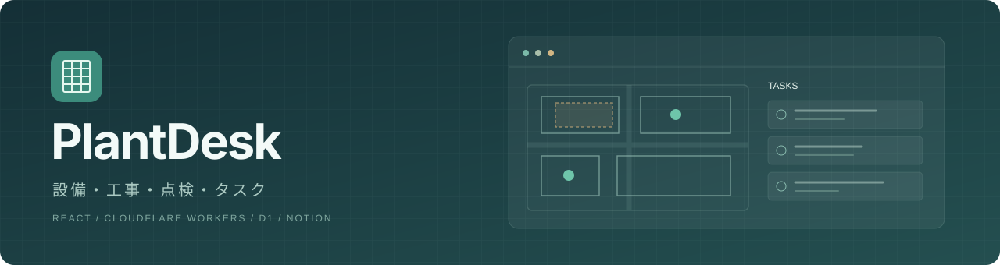
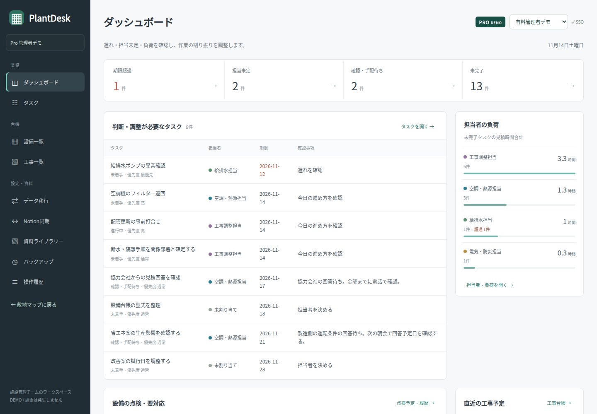
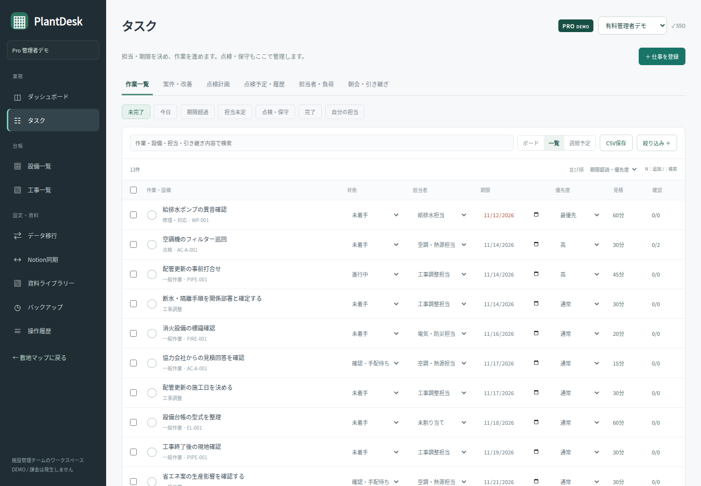
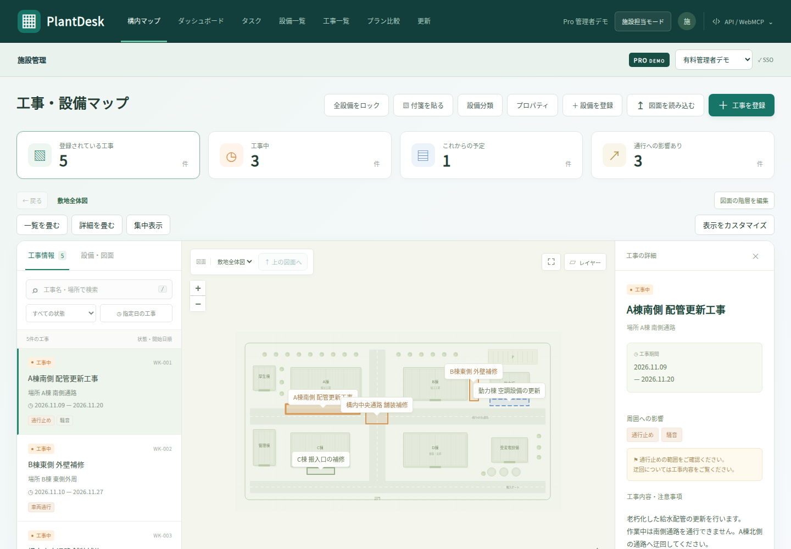
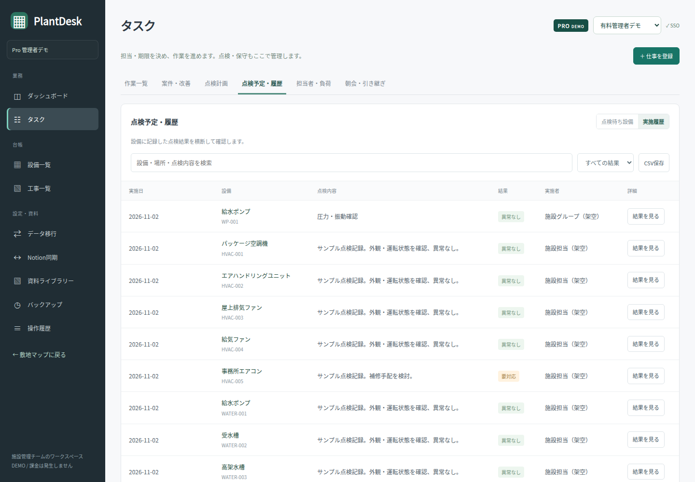
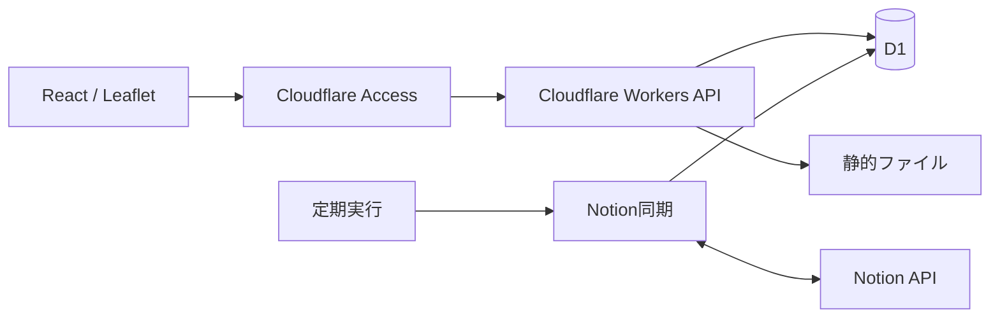

<p align="center">
  
</p>

<p align="center">
  <a href="https://github.com/hiromura16/plantdesk/actions/workflows/ci.yml"></a>
  <a href="LICENSE"></a>
  <a href="docs/development.md"></a>
  <a href="frontend/package.json"></a>
  <a href="docs/cloudflare.md"></a>
</p>

# PlantDesk

工場の設備・工事・点検・タスクを、敷地図とつなげて管理する施設管理ワークスペースです。施設担当者は台帳と作業を管理し、閲覧モードは工事のお知らせに使えます。

**[アプリを開く](https://plantdesk.chaoslab.fyi/) · [ダッシュボード](https://plantdesk.chaoslab.fyi/console.html) · [APIドキュメント](https://plantdesk.chaoslab.fyi/api-docs) · [ドキュメント一覧](docs/README.md)**

> 独自ドメインへの切り替え作業中です。新URLの接続確認後に旧workers.devを停止します。

公開アプリはCloudflare Accessのメール認証で保護しています。サンプルには架空の工場データを使用し、Free / Proの切り替えを体験できます。決済・カード登録・請求の実装はありません。

## 画面

| ダッシュボード                                                            | タスク                                                        |
| ------------------------------------------------------------------------- | ------------------------------------------------------------- |
| [](docs/images/dashboard.png) | [](docs/images/tasks.png) |
| 期限超過・担当未定・負荷を確認し、割り振りを調整します。                  | 一覧から担当・期限・状態を直接編集し、右側で詳細を開きます。  |

| 敷地マップ                                                | 点検予定・履歴                                                                |
| --------------------------------------------------------- | ----------------------------------------------------------------------------- |
| [](docs/images/map.png) | [](docs/images/inspections.png) |
| 設備・工事・図面・資料を場所から確認します。              | タスク画面内で、定期点検計画と実施結果を管理します。                          |

画像はローカルの実装を検証専用データで撮影しています。[開発ガイド](docs/development.md#スクリーンショット)から再生成できます。

## できること

| 分野         | 主な機能                                                                              |
| ------------ | ------------------------------------------------------------------------------------- |
| マップ・図面 | ASCII DXF、図面階層、レイヤーセット、工事範囲、付箋、表示設定                         |
| 設備台帳     | カスタム属性、設備分類・アイコン、写真・PDF、位置と属性のロック、一覧の列・フィルター |
| タスク・保全 | 担当・期限・優先度、一覧・ボード・週間予定、案件、先行作業・子作業、点検計画・履歴    |
| Notion       | 設備・工事・担当・案件・作業・点検の双方向ポーリング同期、競合の明示的な解決          |
| 連携・運用   | REST API、OpenAPI / Swagger UI、WebMCP、CSV / JSON、監査履歴、バックアップ            |

詳細と制限は[機能リファレンス](docs/features.md)、日々の操作は[業務ガイド](docs/team-workflow.md)にまとめています。

## ローカルで動かす

Node.js **22.13以上**、npm、Python **3.12以上**を用意します。

```sh
git clone https://github.com/hiromura16/plantdesk.git
cd plantdesk
npm ci
npm ci --prefix frontend
npm run build
npm run dev
```

表示された `http://127.0.0.1:...` を開きます。開発サーバーは一時SQLiteと開発用の署名済みIDを使用します。終了時に一時DBを削除し、公開DBやNotionには接続しません。実配置は[Cloudflareの手順](docs/cloudflare.md)を参照してください。

## 技術構成



```text
frontend/
  src/console/   # Reactの管理画面・タスク・台帳
  src/map/       # 敷地マップ・設備・付箋・図面
  src/shared/    # ブラウザー共通機能・APIクライアント
  src/styles/    # 自作CSS
  pages/         # HTMLの入口
  static/        # 図面サンプル・画像・第三者ライブラリー
cloudflare/      # Workers API・認証・D1・Notion同期
shared/          # ブラウザーとAPIの共通処理・デモデータ
api/             # OpenAPI仕様
connectors/      # アプリから独立した連携部品
scripts/         # ビルド・開発・品質チェック・撮影
tests/           # API実行環境・画面のテスト
docs/           # 日本語ドキュメント・画像
legacy/          # 旧Rust版・汎用OIDCコンソール
```

`public/` と `frontend/.build/` は生成物です。直接編集せず `npm run build` で生成します。ソースを動かしても配信URLを保つ対応表は `frontend/entries.mjs` にあります。[ソース配置のガイド](docs/source-layout.md)で編集先を確認できます。

## 品質チェック

```sh
npm run format        # Prettierで整形
npm run check         # 整形・ESLint・React Hooks
npm test              # API・認証・同期・入力検証
npm run build
```

CIでも整形・静的解析・API検証・ビルドを実行します。実行環境・ブラウザーテストは[開発ガイド](docs/development.md)、変更の出し方は[CONTRIBUTING.md](CONTRIBUTING.md)を参照してください。

## 現在の範囲

- **DWGはDXFへの変換が必要**です。DWGの直接解析は未実装です。
- 台帳全体750KB、添付は各5MB・1回合計5MBまでです。
- 名簿は割り当て用です。ログインユーザーの招待は別工程です。
- Notionの本文・コメントや図面・添付ファイル本体は同期しません。
- 実決済、大規模データの正規化、負荷試験、監視・復旧運用は今後の対応範囲です。

## ライセンス

[MIT License](LICENSE)。同梱ライブラリーは[THIRD_PARTY_NOTICES.md](THIRD_PARTY_NOTICES.md)、問題の報告方法は[SECURITY.md](SECURITY.md)を参照してください。
