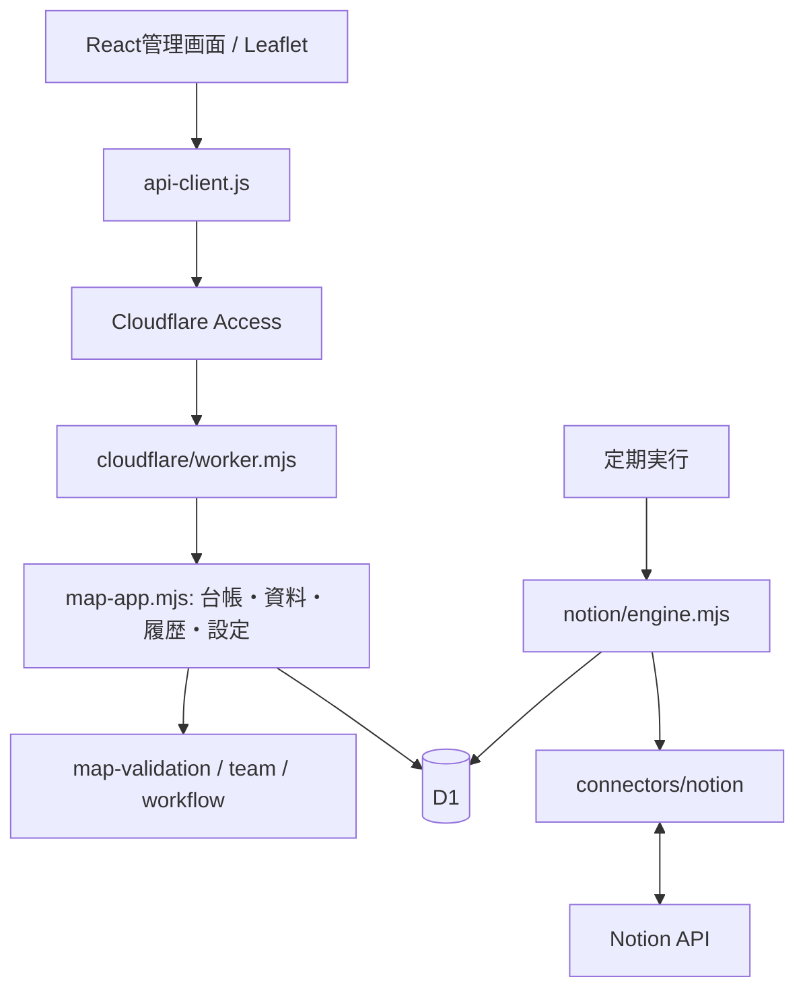

# アーキテクチャ

## 実行経路

現行SaaSはReact / LeafletとCloudflare Workers / D1で構成します。旧Rust / PostgreSQL版は `server/` に残していますが、SaaS版とは別の実行経路です。

## 画面の責務

| モジュール                                | 役割                                           |
| ----------------------------------------- | ---------------------------------------------- |
| `frontend/product.jsx`                    | アカウント、業務メニュー、台帳・設定の切り替え |
| `team-dashboard.jsx`                      | 遅れ・担当未定・負荷・点検・工事の集計と導線   |
| `team.jsx`                                | タスクの絞り込み・保存・選択・詳細の制御       |
| `task-views.jsx`                          | 一覧・ボード・週間予定とタスクカード           |
| `team-task.jsx`                           | 詳細の編集、未保存保護、完了、コメント、資料   |
| `team-plans.jsx` / `team-inspections.jsx` | 点検計画、次回点検、実施結果                   |
| `app.js` とマップ用スクリプト             | 地図、描画、設備、付箋、レイヤー、図面         |

## データと保存

デモの台帳は組織ごとの `organizations.state_json` に保存します。工事・タスクの変更イベント、表示設定、資料チャンク、バックアップ、Notionの接続・対応表は別テーブルです。リビジョンによって同時更新を検出します。

点検完了時はタスク・設備の点検履歴・必要なフォロー作業を同じ更新にまとめます。完了条件、先行・子作業、チェック項目はAPIとNotion同期からも検証します。

小規模デモの構成です。大量データでは台帳の正規化・分割、ページング、資料のR2保存が必要です。[現在の制限](features.md)を参照してください。

## 認証と権限

AccessがWorker全体を保護します。Workerは署名・issuer・audience・有効期限を検証し、認証済みIDから組織を特定します。Free / Proのデモデータは分離します。担当者名簿はログインユーザーの招待とは別です。

閲覧モードには公開対象の工事・付箋・図面だけを返します。設備・点検資料・タスク・履歴は施設担当モードでのみ扱います。

## Notion同期

Webhookは使わず、Cronが要求と次回予定を確認します。API・DB操作の予算で処理を区切り、保存したカーソルから再開します。トークンは組織ごとに暗号化して保存し、API応答へ返しません。

両側の値と直前の同期値を比較し、重ならない変更はマージします。同じ項目の競合と削除は利用者の選択を待ちます。本文・コメント、図面・添付ファイル本体は同期対象外です。
